# 轻律生活 · EasyLife

> 一款卡路里记录 App。记完一顿饭，水位涨一截、晃两下、归于平静。

**uni-app x（Vue3 + UTS/TS）· 一套代码三端运行：Android App / 微信小程序 / Web H5 · 本地存储 · 无服务器**

###🌐 在线体验（Web H5）

**https://easylife-c7x.pages.dev** —由 master 分支自动部署到 Cloudflare Pages，改代码即上线。

[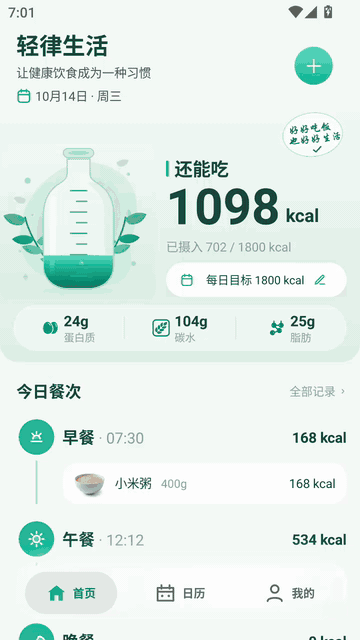](docs/media/demo_light.mp4)

> 🎬 **67 秒走完一遍核心链路**：薄荷亮态首页（还能吃 1098 kcal / 已摄入 702）→ 点击水瓶液体晃动 → 我的 → 设置 → 打开深色模式 → 回首页看暗态 → 依次切换**海洋／薰衣草／薄荷** 三套主题，每换一次回首页看整体换肤。
> 高清视频见 [`docs/media/demo_light.mp4`](docs/media/demo_light.mp4)；原始高码率版本归档于 `demo.mp4`。

---

## 三端一览

同一套 `.uvue` 源码，编译到三个目标。**主验证端＝Android**（uni-app x 原生渲染），小程序与 H5 为辅助链路。

| Android App | 微信小程序 | Web H5 |
|---|---|---|
|  | 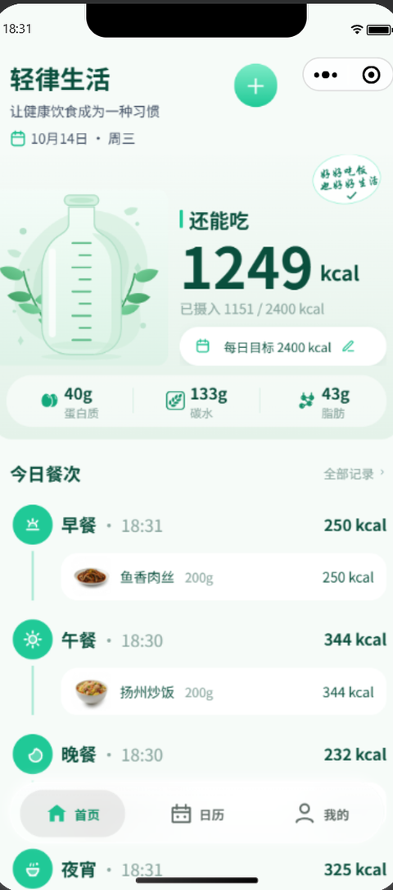 | 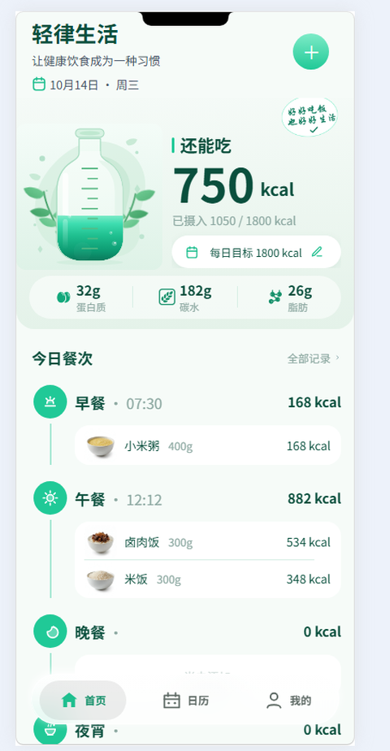 |
| **Android 原生渲染**<br>模拟器 1440×2560<br>目标 1800 kcal | **微信小程序**<br>开发者工具 iPhone 框架<br>目标 2400 kcal | **Web H5**<br>[**线上可访问**](https://easylife-c7x.pages.dev)<br>Cloudflare Pages<br>目标 1800 kcal |
| 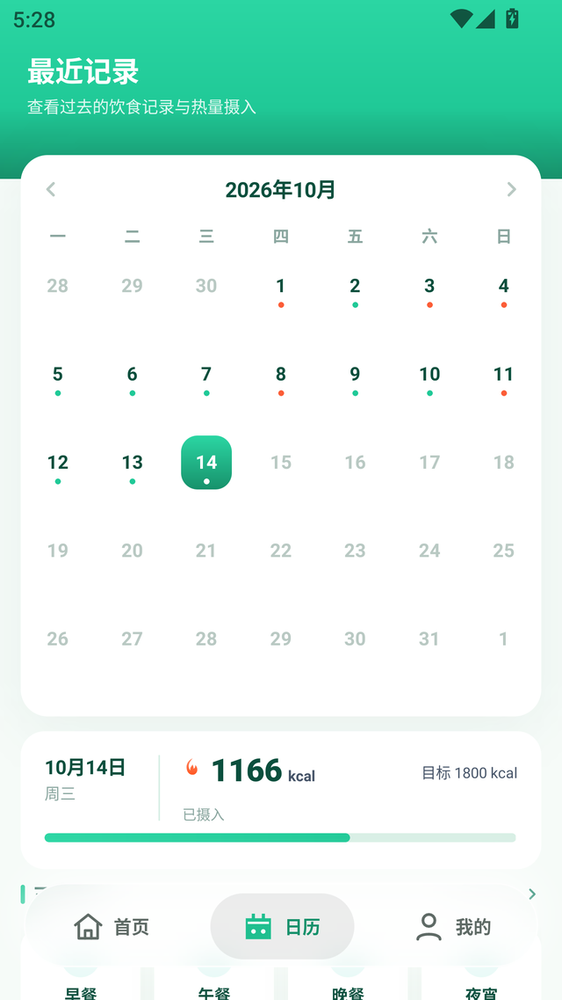 | 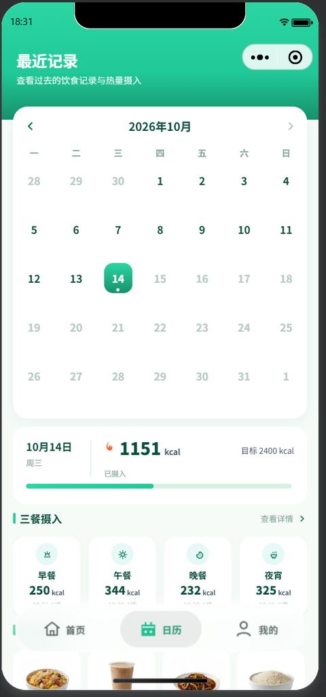 | 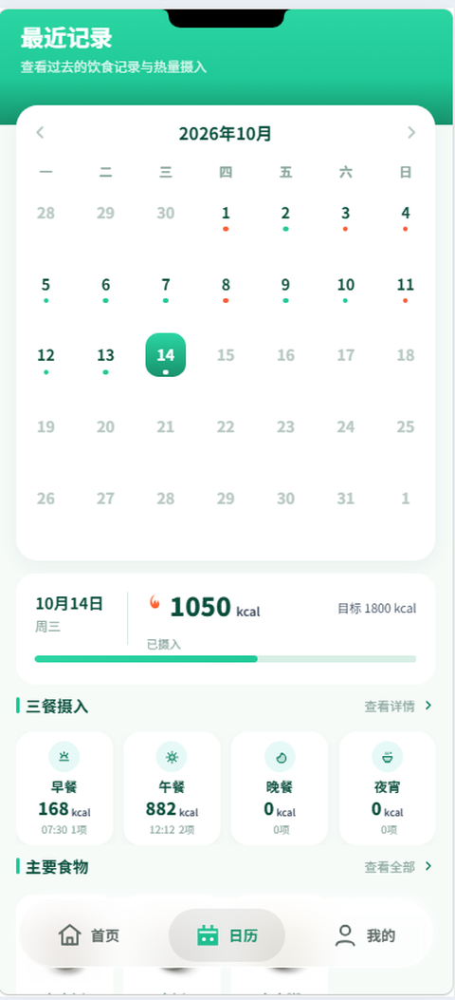 |
| **日历 Tab**：达标色点（绿/橙/珊瑚） | **最近记录**：胶囊按钮按小程序规范内移避让 | **最近记录**：同一份代码，Web 端渲染 |

小程序端有**独家页面**——食物百科（带营养点评与「添加到晚餐」直连）：

| 小程序 · 食物百科 |
|---|
| 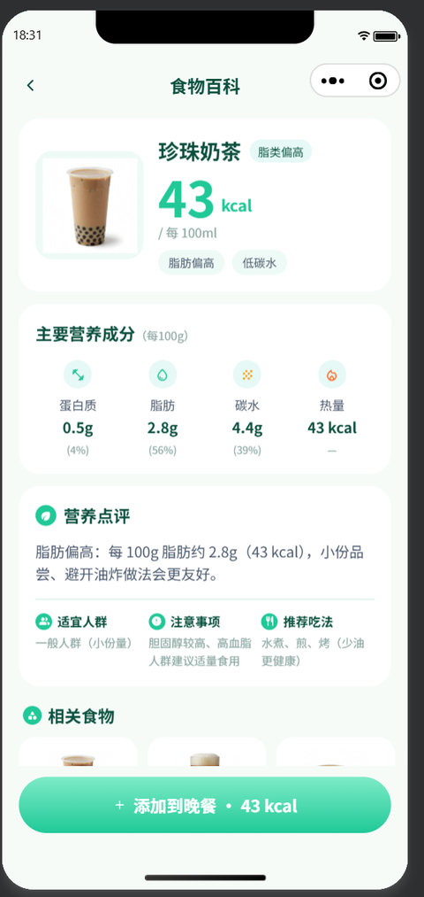 |
| 热量构成环形 + 蛋白质/脂肪/碳水占比 + 营养点评 + 适宜人群/注意事项/推荐吃法 + 相关食物横滑，底部一键按当前餐次添加。 |

> **三端数据各自独立**（本地存储，不跨端同步），故截图里的每日目标与当日记录不同——这是设计如此，不是 bug。

<details>
<summary><b>Web 端部署方式（Cloudflare Pages）</b></summary>

Web 端走**「本地发行 + 仓库托管产物」**：uni-app x 的编译器集成在 HBuilderX 内部，项目无 `package.json` / `vite.config`，Cloudflare 环境里编不出来，所以产物需本地编译后入库。

```powershell
# 1. HBuilderX GUI：右键 app 根节点 → 发行 → 网站-PC Web 或手机 H5
#    ⚠️ 必须选中项目根节点，不是 index.html 文件，否则菜单里没有 Web 项
# 2. 产物拷入 web/
rm -rf web && mkdir -p web
cp -r app/unpackage/dist/build/web/. web/
# 3. 自检（实测引用形态 / 路由模式 / 产物规模 / 探活）
python toolchain/verify_web_deploy.py
# 4. 推送即触发 Cloudflare 自动部署
git add web/ && git commit -m "chore(web): 更新 Web 发行产物" && git push origin master
```

**Cloudflare Pages 配置**：框架预设「无」/ 构建命令留空 / 构建输出目录 `/web` / 生产分支 `master`。

因为产物实测为**根绝对路径引用 + hash 路由**，所以**不需要任何 SPA rewrite 规则**。产物 795 文件 / 9.7MB（其中 6.4MB 是 347 张食物图标的 WebP），已压缩、无 sourcemap。

详见 [`web/_cloudflare.md`](web/_cloudflare.md)。

</details>

---

## 一、为什么要做这个 App

两个动机叠在一起：

**控制每天的卡路里摄入。** 我自己需要一款工具记录每天吃了多少、离目标还有多远。市面上的记录 App 要么太重（要注册、要联网、订阅制），要么太轻（只有一个数字，没有反馈感）。我想做的是**打开就能记、记完就能看到反馈**的轻量工具 —— 全部数据存在本机，不联网、不注册、卸载即清空。

**顺便完整地学一遍「如何用 AI 设计出一款 App」。** 这个项目同时是我的 AI 协作练习：从需求文档 → 设计资产 → 原型 → 高保真设计图 → 代码实现 → 真机验收，全链路走一遍，把 AI 在设计环节能干什么、不能干什么搞清楚。

### 设计目标

记饮食最容易放弃的原因是「反馈太抽象」——你只知道多了 300 大卡，不知道这相当于多少。所以核心设计决策是：**用水瓶做进度反馈**。

| 目标 | 设计解法 |
|---|---|
| 一眼看出今天吃得怎么样 | 首页巨型水瓶，水位＝摄入占比，晃动物理反馈 |
| 超标要有感知但不被劝退 | 三档色（绿 / 琥珀 `#E8B54D` / 珊瑚 `#FF9E7D`），**不用红色** |
| 记一笔要快 | 首页「+」→ 搜索/分类 → 选分量 → 确认，**4 次点击完成** |
| 数据要可信 | 347 条食物内置、营养成分齐全、每餐自动归档 |

---

## 二、项目怎么落地的（工作流）

这个项目最想记录的不是结果，而是**过程**——从零到能跑在真机上的完整链路：

```
① 产品文档（PRD）
      ↓
② 设计资产（DesignTokens：色值 / 字号 / 圆角 / 三主题 × 亮暗矩阵）
      ↓
③ 交互原型（app/prototype/ HTML 可点击原型）
      ↓
④ AI 生图 → 高保真设计图（ChatGPT 出视觉稿 → 导入 Pencil 精修）
      ↓
⑤ 代码实现（WorkBuddy 通过 MCP 连微信开发者工具，生成接近 1.0 的版本）
      ↓
⑥ 真机验收（开安卓模拟器跑起来，查漏补缺）
      ↓
⑦ 视觉微调（发现真机字太小 → rpx + px 逐页调）
```

### 几个关键的实践点

**设计先行。** `design/DesignTokens.md` 是色值、字号、圆角的唯一事实来源，代码里的任何颜色都要能对应到它。这避免了「页面之间慢慢长成两套设计系统」。

**AI 出图有随机性，所以资产要留档。** 食物图标是 AI 生的，但 `assets/icons-gen/` 保留了原始 PNG 入库——因为生图不可复现，不留档就补不回来。

**真机是唯一标准。** 设计稿上 15px 的字看着舒服，真机上就是小。第五、六步的价值就在于：「发现很多地方字太小 → 用 rpx + px 对每个页面做微调」这个迭代，只有真机能暴露。

**文档即上下文。** 项目的踩坑记录比代码还厚（`docs/decisions/` 五份 ADR、`docs/总结uniappx项目的坑与经验.md`），因为 uni-app x App 端有一批「Web 上能写、原生上静默失效」的坑，值得被记住。

---

## 三、技术栈

| 层 | 技术 |
|---|---|
| 框架 | uni-app x（Vue3 语法，UTS/TS 编译为原生代码） |
| 目标端 | **Android（Vapor 原生渲染）／ 微信小程序 ／ Web H5**（线上：[easylife-c7x.pages.dev](https://easylife-c7x.pages.dev)） |
| 状态 | Pinia（6 个 store：food / settings / goal / user / device / encyclopedia） |
| 存储 | `uni.setStorageSync` 本地存储，**无服务器** |
| 渲染 | 原生渲染 + Canvas 2D（水瓶液体、结算环） |
| 主题 | 三主题（薄荷 / 海洋 / 薰衣草）× 亮暗 = **6 档 token 矩阵**，逐元素 `:style` 绑定 |
| 数据线 | Python（`toolchain/`）：YAML → JSON、图标生成变体、提交闸门 |

**规模**：8 条路由 / 9 组件 / 6 store / 347 条食物库 / 约 1.2 万行 `.uvue` + `.ts`。

---

## 四、界面预览（Android 端）

> 以下截图取自 **Android 模拟器 · uni-app x 原生渲染**（1440×2560 原图缩至 640 宽）。演示数据为内置种子（10/1~10/14 真实饮食节奏，日历红/橙/绿混排）。小程序与 Web 端截图见上方「三端一览」。

### 首页 · 记录流

| | |
|---|---|
|  | 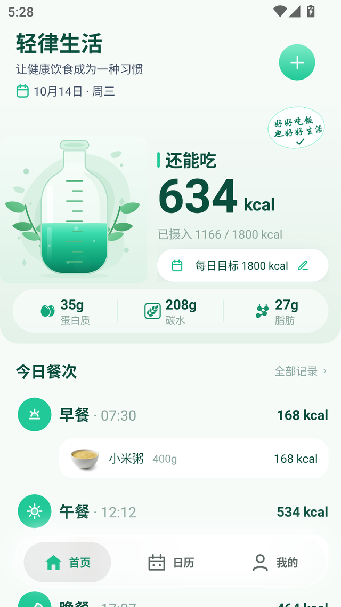 |
| **首页**：巨型水瓶水位＝今日摄入占比，还能吃 1098 kcal，三大宏量营养素。今天记录了早餐和午餐，还剩晚餐和夜宵。 | **添加食物后**：水位实时上涨、剩余热量同步减少——这是 App 最核心的反馈闭环。 |

### 三主题 × 亮暗 = 6 档

同一页面，换主题不只是换主色——图标、贴纸、液体渐变、玻璃胶囊**一并随动**。（动态效果见顶部演示视频的后半段）

| 薄荷 Mint | 海洋 Ocean | 薰衣草 Lavender |
|---|---|---|
|  | 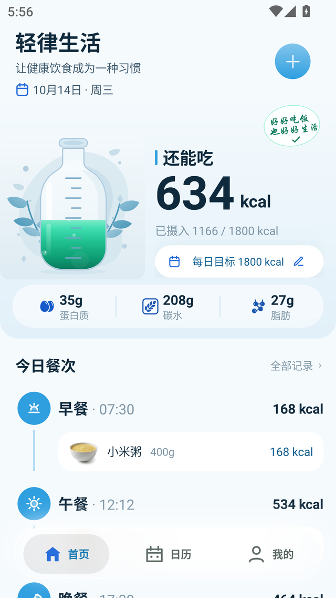 | 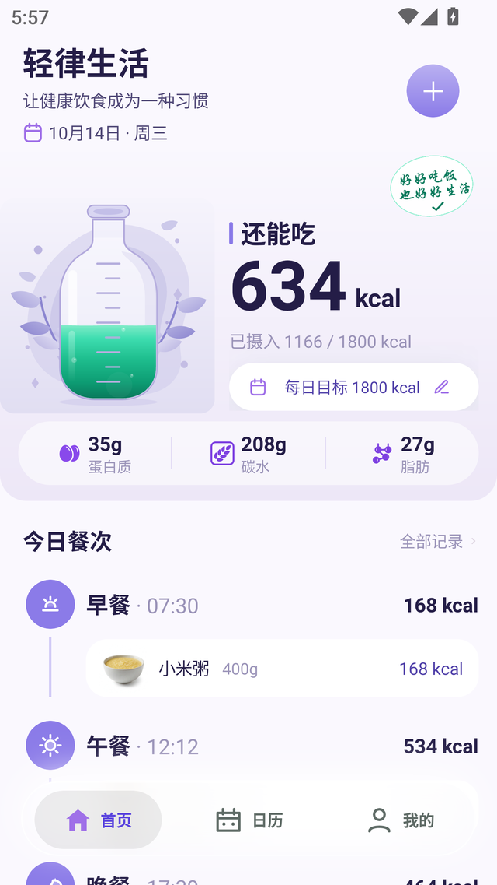 |

亮暗对比（左：亮态 / 右：暗态）：

| 首页 · 亮态 | 首页 · 暗态 |
|---|---|
|  | 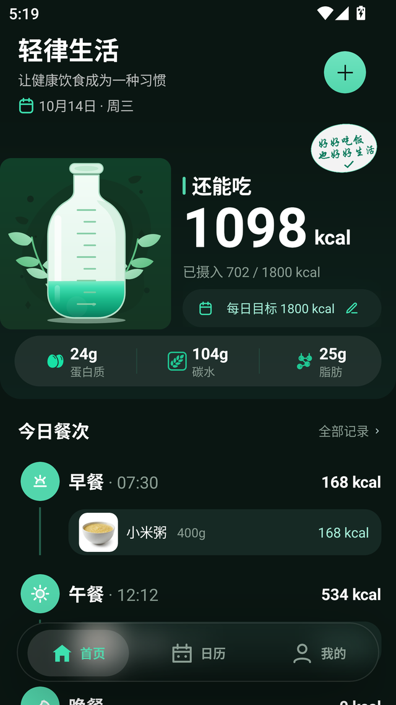 |
| 薄荷绿 `#7DEBC7→#1FBF8F` 渐变瓶、白色玻璃 TabBar 胶囊 | 深墨绿瓶身、胶囊转深色玻璃、贴纸与刻度同步降亮度 |

### 添加食物（单弹层两步，4 次点击完成）

| 食物列表 | 分量与餐次 |
|---|---|
| 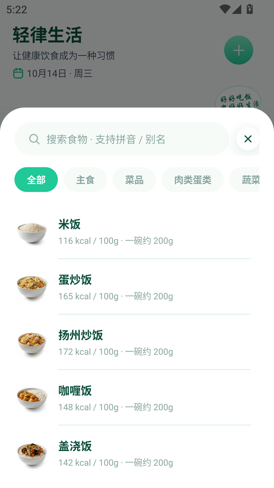 | 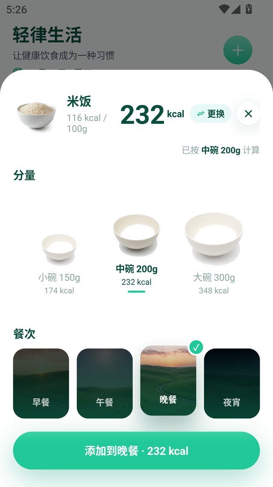 |
| 347 条内置食物，搜索支持拼音/别名，分类 chip 横滑，缩略图 +「每 100g / 一碗约」双口径热量。 | 器具三档图示 + 餐次四卡（按当前时间自动预选），底部实时算 kcal。**点选后原地切步，不销毁重建**。 |

### 其余页面

| 日历 | 个人中心 | 设置 |
|---|---|---|
|  | 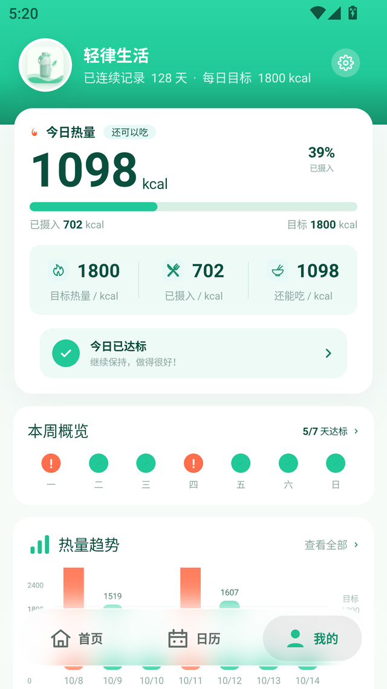 | 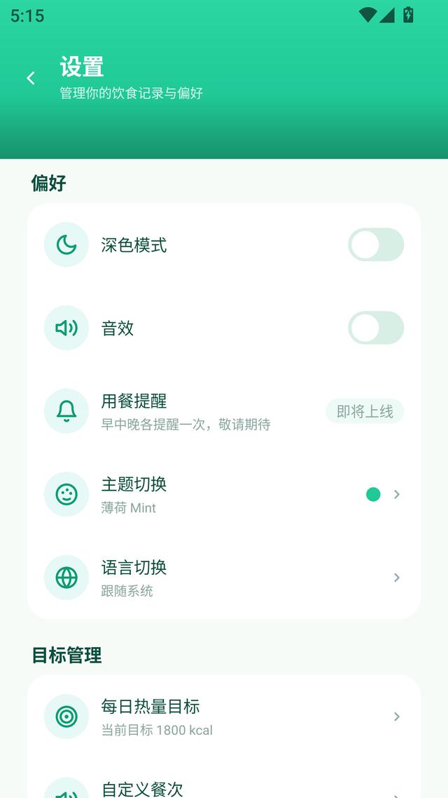 |
| 月历每日带达标色点（绿/橙/珊瑚），下方是选中日三餐摄入 + 主要食物。 | 今日热量三格、本周概览7 点、热量趋势柱状图（超标日用珊瑚色）。 | 深色模式 / 音效 / 用餐提醒 / 主题 / 语言（177 组中英词条）+ 目标管理。底部明示「数据仅存本机」。 |

---

## 五、核心实现

### 水瓶液体（Canvas 2D 物理引擎）

首页水瓶不是图片，是**实时渲染的物理模拟**：

- 双模强迫阻尼振荡器（M1: cos(πu)，T=460ms，ζ=0.14；M2: sin(4πu+φ)，0.955 衰减，dt 归一化）
- 34 段表面路径 + 气泡池 8 + 粒子池 12
- 点击瓶身注入扰动，晃动两下后归于平静
- **首次进入不晃动**（安静开场）

代码在 `composables/useLiquid.ts` + `components/BottleLiquid.uvue`。

### 主题系统（6 档token 矩阵）

三主题 × 亮暗 = 20 个角色 token（`paletteFor()` 查表）。关键决策：**不用 CSS 变量**，改为逐元素行内 `:style` 绑定——因为 uni-app x 原生端没有可靠的层叠与 CSS 变量通道。

### 三档色规则（唯一权威）

`stores/goal.ts` 的 `getCalorieStatus(已摄入, 目标)` 是全App 进度 UI 的唯一判据：

| 占比 | 状态 | 色值 |
|---|---|---|
| ≤ 100% | 达标 | 该档主题 accent（薄荷绿） |
| 100~150% | 超标 | 琥珀 `#E8B54D` |
| > 150% | 严重超标 | 珊瑚 `#FF9E7D` |

**超标不用红色**——红色是报错色，珊瑚既有警示感又不劝退。

### 设备能力分档

检测机型/芯片后分high / mid / low 三档，低档自动关闭触觉反馈、液体波纹、毛玻璃。检测逻辑在 `composables/useDeviceCapability.ts`。

---

## 六、快速上手

```powershell
# 数据线
python toolchain\validate.py              # 源文件一致性校验
python toolchain\build.py                 # YAML → app/src/data/*.json
python toolchain\gen_theme_variants.py    # SVG 底稿 → 主题变体
python toolchain\hooks.py all             # 跑五道提交闸门
python toolchain\hooks.py install         # 新机器必跑

# App 编译（HBuilderX 图形模式，uni-app x 无独立 CLI 构建入口）
& "D:\soft\HBuilderX\cli.exe" launch app-android --project <项目路径>\app
```

> ⚠️ 差量编译不会重编视图层字节码＝假绿。改了模板/样式后必须跑一次完整 `launch`，并核对 `bytes/` 的 mtime。

---

## 七、目录结构

| 路径 | 说明 |
|---|---|
| `app/` | uni-app x 项目根（`pages/` + `components/` + `stores/` + `composables/` + `static/`） |
| `app/src/data/` | 生成物，严禁手写：`food_library.json` + `food_encyclopedia.json` |
| `design/DesignTokens.md` | ★ 色值 / 字号 / 圆角唯一事实来源 |
| `docs/decisions/` | 架构决策记录 ADR（TabBar 玻璃胶囊 / 渲染红线 / 调试坑位等 5 份） |
| `docs/总结uniappx项目的坑与经验.md` | uni-app x 踩坑实录，按「症状→根因→解法→落点」组织 |
| `docs/screenshots/` | README 用的界面截图（`01_`~`18_` Android／`mp-` 小程序／`h5-` Web） |
| `docs/media/` | 演示视频与 GIF |
| `web/` | Web(H5) 发行产物，Cloudflare Pages 直接托管（部署说明见 `web/_cloudflare.md`） |
| `toolchain/` | 数据处理与生成脚本（Python）＋ 提交闸门 `hooks.py` |
| `assets/icons-gen/` | AI 生图原始 PNG 留档（生图不可复现，必须留） |

更多结构事实见 [`project-map.md`](project-map.md)。

---

## 八、已知待办

- [ ]营养数据人工核对（当前为AI 初稿 + 脚本配平，未经权威来源逐项确认）
- [ ] 气泡飞行动画的 Worklet 实现（现仅小程序端 CSS transition，App 端为阶段跳变）
- [ ] `backdrop-filter` 原生端支持度未验（代码已用 `#ifdef MP-WEIXIN` 包住小程序分支）
- [ ] 「数据管理 / 备份」功能（1.0 暂不做，见 `docs/plan-2026-09-28-records-nav-and-backup.md`）

> 完整进度与决策历史见 [`docs/progress.md`](docs/progress.md)。