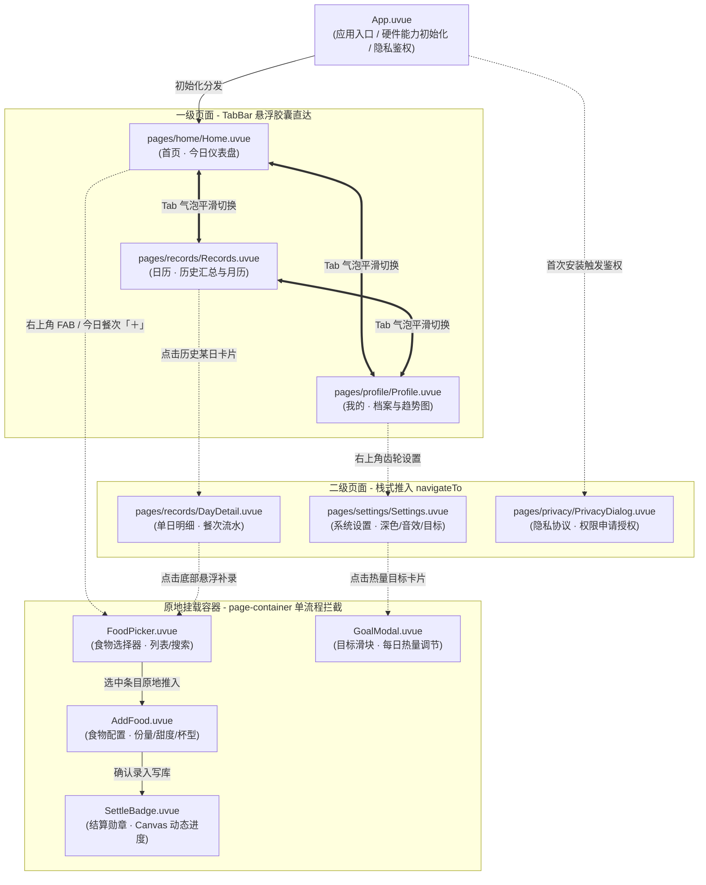
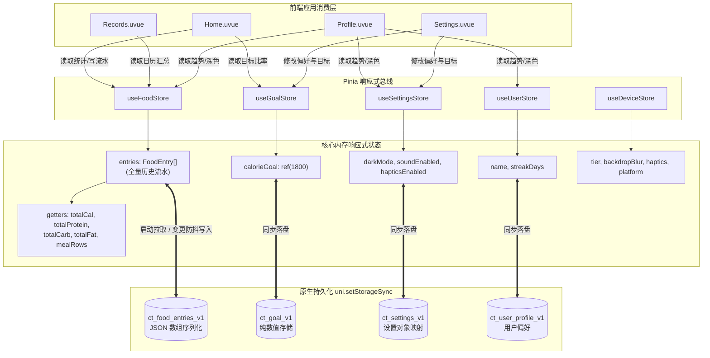

# CalTrack — 卡路里管理 App

轻量级卡路里追踪 App，快速记录饮食，直观展示摄入数据。

<!--
[变更日志]
修改时间：2026-09-23
AI模型：Gemini 系列
修改内容：[将项目地图彻底重构为生产级超精细工程全景蓝图：1. 绘制路由流向与生命周期状态机；2. 细化源码级物理拓扑与符号索引；3. 绘制页面微架构与 DOM 挂载树；4. 完善组件契约、插槽与事件矩阵；5. 建立完整领域模型与数据字典规范；6. 梳理 Pinia 状态流与持久化体系；7. 明确硬件能力分档与降级矩阵；8. 披露流体正弦波与对数刻度数学模型；9. 固化数据流水线与五道质量闸门]
-->
<!--
[变更日志]
修改时间：2026-09-23
AI模型：Gemini 系列
修改内容：[深度重构项目工程全景地图：细化到 5 大页面微架构子模块、8 大组件输入输出契约、5 大 Store 响应式拓扑与持久化表、核心用户交互端到端时序流、以及数据工具链六源流转管道]
-->
<!--
[变更日志]
修改时间：2026-09-23
AI模型：Gemini 系列
修改内容：[构建完整项目全景地图（Project Map）：涵盖页面路由流向、单流程弹层体系、组件与状态拓扑、以及从数据源到 App 的单向数据流全景图，便于开发者快速全局导览]
-->
<!--
[变更日志]
修改时间：2026-09-22
AI模型：Qoder (Claude)
修改内容：[「当前状态」的 TabBar 一句滞后更正：原写「玻璃底随滚动渐显」，该 fade 机制已被 Boss 拍板废弃，
  现为「三 Tab 悬浮液态玻璃胶囊＋会跑的选中气泡」，且「最近记录」由二级页升为一级 Tab（真值见 AGENTS.md 玻璃面条与 docs/progress.md 同日进度）]
-->
<!--
[变更日志]
修改时间：2026-09-22
AI模型：Qoder (Claude)
修改内容：[「当前状态」滞后修正（原写「设计完成，开发未开始」，实际 MVP 主体已在微信模拟器跑通）；
  目录表补 design/DesignTokens.md、ScreenSpecs.md、docs/progress.md、app 源码结构、debug/ 与 assets 图标三兄弟，
  并标注 icons-final 已不进版本控制；食物库条数按实际产出修正，交互原型版本号不再硬编码]
-->

## 当前状态

**MVP 主体已落地**：5 页（首页／个人中心／设置／最近记录／单日详情）＋ 8 组件 ＋ 5 store 在微信开发者工具跑通，
353 条食物库内置，弹层走原生 page-container，TabBar＝三 Tab 悬浮液态玻璃胶囊（首页／日历／我的，选中气泡会飞行；「最近记录」已升为一级 Tab）。
当前阶段＝还原度收尾 ＋ 工程化加固（提交闸门 `toolchain/hooks.py` 已上岗）。
动态进度与接手清单见 **`docs/progress.md`**（最高事实来源）。

## 项目高精工程地图 (Ultra-Granular Project Blueprint)

### 1. 路由流向与生命周期全景 (Navigation Topology & Page Lifecycle)

应用采用纯原生自定义无缝导航（全量 `navigationStyle: custom`），页面流转矩阵如下：



#### 页面流转参数与生命周期行为规范表

| 路由地址 (`pages.json`) | 页面类型 | 进栈方式 | 入参 (`options`) | 状态栏字色 (`syncBar`) | 核心生命周期行为 |
|---|---|---|---|---|---|
| `pages/home/Home` | 一级 Tab | 应用根入口 / 胶囊直切 | 无 | 恒定浅色背景 (black 字色) | `onShow`: 触发数据响应式重算；`onMounted`: 水瓶物理正弦波入场 |
| `pages/records/Records` | 一级 Tab | 胶囊直切 | 无 | 恒定浅色背景 (black 字色) | `onShow`: 刷新当月月历圆点及选中日汇总；内嵌 `<scroll-view>` 全量丝滑滚动 |
| `pages/profile/Profile` | 一级 Tab | 胶囊直切 | 无 | 浅色: black / 暗色: white | `onShow`: 随 `settings.darkMode` 动态反转状态栏字色；渲染 7 日柱状图 |
| `pages/records/DayDetail` | 二级页 | `navigateTo` | `foodStore.viewDay` 隐式传参 | 恒定浅色背景 (black 字色) | `onLoad`: 读取指定日期流水；支持长按餐次条目拉起原生删除 |
| `pages/settings/Settings` | 二级页 | `navigateTo` | 无 | 浅色: black / 暗色: white | `onShow`: 同步状态栏；操控 `darkMode` 响应式触发个人中心与全局开关 |
| `pages/privacy/PrivacyDialog` | 独立弹窗 | `navigateTo` (透明栈) | 无 | 黑色半透明遮罩 | 拦截隐私授权 API，用户拒绝后阻断流程 |

---

### 2. 系统源码物理拓扑与符号索引 (Source-Level Topology & Symbol Index)

```
kaluli/
├── 📄 AGENTS.md                   # 静态技术宪法（多端硬约束 / 避坑指南 / 类名前缀规范 / 提交红线）
├── 📄 README.md                   # 项目全景概览与高精工程地图
│
├── 📂 docs/                       # 过程与决策事实库
│   ├── progress.md                # ★ 最高动态事实来源（新会话第一顺位启动文档，带秒级时间戳）
│   ├── PRD.md                     # 当前生效产品需求文档
│   ├── Review.md                  # 关键架构评审复盘记录
│   ├── FoodLibraryPlan.md         # 353条食物库规划与体积核算账目
│   └── design/                    # 各期专项设计交付与方案（含 liquid-glass-tabbar 专项）
│
├── 📂 design/                     # 视觉规范与设计真理源
│   ├── DesignTokens.md            # ★ 色值/圆角/字号唯一真理（导出自 Ardot 变量集，严禁自创色）
│   ├── VisualLanguage.md          # 视觉语言（薄荷液滴 Mint Drop 物理动效）
│   ├── ScreenSpecs.md             # 8 屏高保真对照规格（量取几何/间距）
│   └── IconPlan.md                # 全局高清晰度矢量 SVG 图标方案
│
├── 📂 app/                        # 前端应用层 (uni-app x + Vue3 + TS + Pinia)
│   ├── pages.json                 # 页面路由表（5 页全部 navigationStyle:custom）
│   ├── manifest.json              # 应用配置（声明 uni-app-x 与 vapor 蒸汽模式）
│   ├── App.uvue                   # 根应用组件（全局设备能力检测与隐私弹窗拉起）
│   ├── pages/                     # 业务页面集（每页均配同名 .md 文档）
│   │   ├── home/Home.uvue         # 首页（常驻顶栏 + 水瓶流体物理动效 + 宏量卡 + 餐次列表）
│   │   ├── records/               # 记录与日历模块
│   │   │   ├── Records.uvue       # 一级 Tab「日历」：月历卡 + 选中日汇总 + 三餐卡 + 主要食物
│   │   │   └── DayDetail.uvue     # 二级单日详情页：热量总览 + 餐次记录明细 + 长按删除
│   │   ├── profile/Profile.uvue   # 一级 Tab「我的」：达标大卡 + 7日热量趋势 + 遮罩防穿透
│   │   └── settings/Settings.uvue # 设置页：深色模式切换 + 目标修改入口 + 音效/触觉开关
│   ├── components/                # 8 大公共组件集（类名全量统一前缀，各配同名 .md）
│   │   ├── Tabbar.uvue            # 悬浮液态玻璃胶囊底栏（三 Tab，飞行气泡动效）
│   │   ├── FoodPicker.uvue        # 原生 page-container 单流程食物添加容器（列表+内嵌详情）
│   │   ├── AddFood.uvue           # 食物规格、份量、杯型、甜度与餐次配置面板
│   │   ├── SettleBadge.uvue       # 结算徽章弹窗（Canvas 2D 居中动态进度弧 + 计数滚动）
│   │   ├── GoalModal.uvue         # 每日目标调整弹窗（横向滑条 + 5个预设药丸胶囊）
│   │   ├── CountStepper.uvue      # 精准份量数值步进器
│   │   ├── OptionTray.uvue        # 杯型与甜度选项托盘
│   │   └── FoodToast.uvue         # 轻提示组件（备用链路）
│   ├── stores/                    # Pinia 状态管理层（各配同名 .md）
│   │   ├── food.ts                # 食物库 353 项检索、记录 CRUD、今日总摄入与宏量计算
│   │   ├── goal.ts                # 每日卡路里目标与达成状态判定（达标/接近/超标）
│   │   ├── settings.ts            # 全局设置、深色模式、Web Audio 音效引擎与触觉反馈
│   │   ├── user.ts                # 用户基础档案（打卡天数、昵称、个人偏好）
│   │   └── device.ts              # 硬件机型判定与能力分档（high / mid / low 降级中枢）
│   └── static/                    # 静态资产集（icons 353 张 512 WebP、meals、home、common）
│
├── 📂 toolchain/                  # 离线数据流水线与质量闸门（Python，不进 App 包）
│   ├── sources/                   # 6 份 YAML 数据源（icons/nutrition/visual/usage/vessel/opts）
│   ├── validate.py                # 跨源数据完整性与 id 一致性强校验器
│   ├── build.py                   # 多源合并打包成 JSON ＋ 图标增量同步到 app/static/icons/
│   ├── hooks.py                   # 提交与会话收口五道质量闸门（安装至 .git/hooks/pre-commit）
│   └── compress_icons.py          # PNG 批量压缩转为 512 极限体积 WebP
│
└── 📂 debug/                      # 自动化调试与探针套件 (Node.js)
    ├── shot.js                    # miniprogram-automator 无窗口极速后台截图探针
    └── tab_geom.js / etc.         # 胶囊几何测量、毛玻璃像素采样与动效时序取证工具
```

---

### 3. 页面微架构与 DOM 挂载树 (Page Micro-Architecture & Visual Hierarchy)

#### 3.1 首页 (`Home.uvue`) 层次微架构
```
┌────────────────────────────────────────────────────────────────────────────────────────┐
│ [页面容器] .page (背景: #F2FAF5, 动态安全区避让: padding-bottom: calc(82px + env(safe)))  │
│ ├─ [常驻吸顶栏] .hm-nav (z-index: 45, 固定顶部, 高度: statusBarHeight + 220rpx)           │
│ │   ├─ 状态栏安全占位 .status-bar-placeholder                                          │
│ │   ├─ 标题行 .nav-header: 日期文案「今天 · 9月23日」 + 右上角悬浮加号 FAB「＋」          │
│ │   └─ 副标题文案 .nav-subtitle: 「已记录 3 餐」                                        │
│ ├─ [占位隔离槽] .header-spacer (高度精确匹配 220rpx, 防止下方卡片视觉穿顶)              │
│ ├─ [能量水瓶展示区] .hero (自然渐变: linear-gradient(180deg, #E6F8EF 0%, #F2FAF5 100%))   │
│ │   ├─ 流体水瓶外壳 .bottle-wrap (物理尺寸: 136px × 204px)                              │
│ │   │   ├─ 内部流体型腔 .bottle-cavity (限制最大水位高度 80%, overflow: hidden)         │
│ │   │   │   ├─ 动态流体层 .liquid-fill (translateY 实时映射热量摄入比例)                │
│ │   │   │   └─ 正弦双波浪 .wave-front / .wave-back (CSS 关键帧水平对向流动)              │
│ │   │   └─ 悬浮晃动叶片 .floating-leaf (根据晃动物理衰减算法计算微摆角度)               │
│ │   └─ 热量统计大字 .hero-text                                                          │
│ │       ├─ 核心状态数值: 「还能吃 850 kcal」或「已超标 120 kcal」                       │
│ │       ├─ 对比进度条 .hero-bar: 已摄入 / 目标刻度线性映射                              │
│ │       └─ 目标状态药丸 .target-pill: 点击原地呼起 GoalModal                            │
│ ├─ [三大宏量营养素卡片] .macro-card (白卡 r20, 阴影 0 2px 12px rgba(10,79,61,.04))      │
│ │   └─ 3 列黄金分割等宽: 蛋白质 (g) / 碳水化合物 (g) / 脂肪 (g) 实时累计与占比          │
│ ├─ [今日餐次分类流水] .meal-block                                                      │
│ │   └─ 早 / 午 / 晚 / 夜宵 4 组卡片:                                                   │
│ │       ├─ 卡片头: 餐次名称 + 最早打卡时间 HH:MM + 该餐热量小计                        │
│ │       ├─ 明细项列表: 食物 WebP 图标 + 名称 + 份量规格 + 单品热量 (长按触发删除)       │
│ │       └─ 该餐加号按钮: 点击直达 FoodPicker 且预选该餐次                              │
│ ├─ [原生单流程弹层] <FoodPicker v-model:show="pickerShow" />                           │
│ ├─ [结算反馈勋章] <SettleBadge v-model:show="settleShow" />                            │
│ ├─ [目标修改弹层] <GoalModal v-model:show="goalShow" />                                │
│ └─ [悬浮液态玻璃底栏] <Tabbar active="home" /> (定位 fixed, bottom: 22px / safeBottom)  │
└────────────────────────────────────────────────────────────────────────────────────────┘
```

#### 3.2 日历 / 最近记录页 (`Records.uvue`) 层次微架构
```
┌────────────────────────────────────────────────────────────────────────────────────────┐
│ [页面滚动根节点] <scroll-view direction="vertical" class="rec-scroll-container">        │
│ ├─ 顶部绿色渐变大底: linear-gradient(180deg, #32D0A0 0%, #1FBF8F 50%, #159C72 100%)    │
│ │   ├─ 状态栏安全占位 .rec-status-placeholder                                           │
│ │   └─ 大字标题 .rec-title: 「最近记录」                                               │
│ ├─ [月历大卡片] .lr-cal (白卡 r20, 左右翻月, 星期一至星期日 7 列网格布局)               │
│ │   └─ 日期网格项: 日期数字 + 当日状态指示点 (绿色达标 / 琥珀接近 / 珊瑚超标 / 灰色无记录)│
│ ├─ [选中日卡路里汇总卡] .lr-sum                                                         │
│ │   ├─ 动态火焰徽标 + 当日总热量数值大字                                                │
│ │   └─ 目标达成能量槽: 动态比率 + 达标状态文字描述                                     │
│ ├─ [三餐热量卡片网格] .lr-mcard-row (2×2 响应式网格布局: 早餐 / 午餐 / 晚餐 / 夜宵)     │
│ ├─ [主要食物摄入榜] .lr-fcard-row (横向滑块或前 4 项卡片, 食物 WebP 原图 + 摄入量)      │
│ └─ [底部全避让预留槽] .lr-bottom-space (高度: calc(92px + env(safe-area-inset-bottom)))  │
│ └─ [悬浮液态玻璃底栏] <Tabbar active="records" />                                       │
└────────────────────────────────────────────────────────────────────────────────────────┘
```

#### 3.3 单日详情、个人中心、设置与隐私授权微架构
```
┌────────────────────────────────────────────────────────────────────────────────────────┐
│ 3. 单日详情 DayDetail.uvue (二级页面)                                                  │
│ ├─ 常驻动态顶栏 .dd-nav-fixed: 返回箭头 + 当前选中日期文案                             │
│ ├─ 今日热量大卡 .dd-hero: 中心大数字 + 环形进度条 + 能量条 + 三大宏量分布比例           │
│ ├─ 餐次明细组 .dd-meal-card: 按餐次分类展开所吃食物，支持长按单项删除                   │
│ └─ 底部「添加食物」悬浮操作栏: 原地唤起 FoodPicker 补录食物                             │
├────────────────────────────────────────────────────────────────────────────────────────┤
│ 4. 我的 / 个人中心 Profile.uvue (一级 Tab「我的」)                                     │
│ ├─ 状态栏顶遮罩 .pf-st-mask: 浅色/深色模式随动                                         │
│ ├─ 用户信息头图: 昵称、打卡天数与设置齿轮入口                                          │
│ ├─ 今日热量卡 .cal-card: 内嵌达标状态 Banner + 今日摄入/消耗/目标三联统计              │
│ ├─ 7 日摄入趋势柱状图 .trend-card: 近 7 天能量柱动态高度映射                           │
│ └─ <Tabbar active="profile">: 悬浮底栏，支持深色模式随动                                │
├────────────────────────────────────────────────────────────────────────────────────────┤
│ 5. 设置 Settings.uvue (二级页面)                                                       │
│ ├─ 常驻返回导航栏 .set-nav                                                             │
│ ├─ 深色模式开关: 联动 settings.darkMode，控制个人中心与设置页浅暗切换及系统状态栏字色   │
│ ├─ 每日热量目标入口: 点击拉起 GoalModal 横向滑条弹窗                                    │
│ └─ 交互偏好设置: 音效开关 (Web Audio API 双缓冲) 与 触觉反馈开关 (vibrateShort/Long)    │
├────────────────────────────────────────────────────────────────────────────────────────┤
│ 6. 隐私保护弹窗 PrivacyDialog.uvue (二级独立页面)                                      │
│ └─ 居中卡片 .pd-card: 隐私指引文案 + 同意并继续 / 拒绝退出双按钮                        │
└────────────────────────────────────────────────────────────────────────────────────────┘
```

---

### 4. 组件契约、插槽与事件矩阵 (Component Contracts & Events)

| 组件文件 | 职责与设计思想 | Props 输入契约 | Emits 事件签名 | 关联 Store 与性能机制 |
|---|---|---|---|---|
| **Tabbar.uvue** | 三 Tab 悬浮液态玻璃胶囊，选中气泡飞行关键帧动效，底色与折射随滚动透光 | `active: 'home'\|'records'\|'profile'`<br>`dark?: boolean` | `tabChange(key: string): void` | 依赖 `device.backdropBlur`（降级至实色 `#F8FCFA`）；气泡压扁采用物理宽高过渡，严禁 scale 模糊 |
| **FoodPicker.uvue** | 原生 `page-container` 单流程宿主，首屏 20 项分批虚拟截断，毫秒级秒开 | `show: boolean`<br>`selectedId?: string` | `update:show(val: boolean)`<br>`confirm(payload: FoodEntry)`<br>`select(id: string)` | 解决 353 条食物 2500+ DOM 一次性挂载卡死缺陷；内置分类标签与拼音/全拼/首字母三模检索 |
| **AddFood.uvue** | 食物配置面板，份量/单位/杯型/甜度/餐次联动推导，实时计算单品热量 | `foodId: string` | `confirm(payload: FoodEntry)`<br>`change(val: any)`<br>`close()` | 响应式联动 `foodStore.optGroupsOf` 与 `vesselTpl`；内置 `gramsOf` 计件克重折算算法 |
| **SettleBadge.uvue** | 记录成功结算勋章，Canvas 2D 真实像素换算绘制居中环形进度弧，计数平滑滚动 | `show: boolean`<br>`kcal: number`<br>`after: number`<br>`goal: number`<br>`meal: string` | `update:show(val: boolean)`<br>`close()` | 彻底解耦 CSS 与 Canvas 双环冲突；2160ms 自动退出，触发 `settings.playSound('success')` |
| **GoalModal.uvue** | 每日目标调整弹窗，横向胶囊滑轨 + 触摸滑钮，5 组预设药丸胶囊快速吸附 | `show: boolean`<br>`initial: number` | `update:show(val: boolean)`<br>`save(goalVal: number)` | 预设 1200 / 1500 / 1800 / 2000 / 2200 五档；滑动触发 `settings.triggerHaptic('light')` |
| **CountStepper.uvue** | 扁平数值步进器，长按定时器连续递增/递减，边界保护（1~100） | `modelValue: number`<br>`min?: number`<br>`max?: number`<br>`step?: number` | `update:modelValue(val: number)` | 长按 400ms 后以 80ms 周期自加速连续步进；内置 `settings.triggerHaptic('light')` |
| **OptionTray.uvue** | 甜度与规格分段标签选择器，网格平铺，微弹簧选中态动效 | `options: string[]`<br>`modelValue: string` | `update:modelValue(val: string)` | 原地展开，无多余层级抽象，纯原生 flex-wrap 布局 |
| **FoodToast.uvue** | 轻提示气泡，浮层临时通知反馈 | `title: string`<br>`visible: boolean` | `update:visible(val: boolean)` | 顶部居中下弹，60fps 缓动动画 |

---

### 5. 领域实体模型与数据字典规范 (Domain Model & Data Dictionary)

#### 5.1 食物基础模型 (`FoodBase`)
```typescript
interface FoodBase {
  id: string              // 唯一食物ID，如 "p017" (拼音首字母+编号)
  name: string            // 官方标准展示名称，如 "全麦馒头"
  cat: string             // 品类键名，如 "staple" (主食), "drink" (奶茶饮品)
  kcal: number            // 基准热量：每 100g (固体) 或 每 100ml (液体) 的热量 (kcal)
  unit: 'g' | 'ml'        // 基础计量单位
  protein?: number        // 蛋白质含量 (g / 100g|ml)
  carb?: number           // 碳水化合物含量 (g / 100g|ml)
  fat?: number            // 脂肪含量 (g / 100g|ml)
  pieceWeight?: number    // 计件类食物单件平均克重 (g)，如馒头 75g/个
  vessel?: string         // 器具模板引用键，对应 vessel_tpl.yaml (如 "bowl", "cup")
  opts?: string[]         // 选项模板引用键，对应 opts_tpl.yaml (如 ["sweet", "topping"])
  img?: string            // 相对路径，格式为 "<catKey>/<id>.webp"，对应 app/static/icons/
  conf?: number           // 营养置信度评级 (1~5 星)
  source?: string         // 数据源标识: "composition_table" | "recipe_estimate" | "rough_estimate"
  py?: {                  // 离线检索拼音索引
    f: string             // 全拼连写，如 "quanmaimantou"
    i: string             // 首字母缩写，如 "qmmt"
  }
}
```

#### 5.2 摄入记录快照模型 (`FoodEntry`)
> **强制约束**：依据架构宪法，记录必须保存冗余快照，禁止仅存裸 `foodId`，确保底层食物库升级或删条目时，历史账目 100% 完整可溯。
```typescript
interface FoodEntry {
  id: string              // 记录唯一 UUID，时间戳 + 随机位
  foodId: string          // 原始食物引用 ID
  foodName: string        // 冗余快照：食物中文全称
  name: string            // 展示标题（含规格信息）
  kcal: number            // 经过份量缩放 + 加料加糖后的实际最终摄入热量 (kcal)
  protein: number         // 实际摄入蛋白质总量 (g)
  carb: number            // 实际摄入碳水化合物总量 (g)
  fat: number             // 实际摄入脂肪总量 (g)
  ts: number              // 录入物理时间戳 (毫秒)
  meal: string            // 所属餐次: 'breakfast' | 'lunch' | 'dinner' | 'snack'
  amount?: number         // 最终折算等效克重/毫升数 (g/ml)
  unit?: string           // 展示单位
  img?: string            // 冗余快照：图标路径
  source?: string         // 冗余快照：数据源类型
  schemaVersion?: string  // 数据契约版本号，当前为 "v1.0"
}
```

#### 5.3 首页与流水聚合模型 (`MealRow` & `FoodLine`)
```typescript
interface FoodLine {
  id: string              // 对应 FoodEntry.id，供长按删除定位
  key: string             // 列表渲染唯一虚拟 key
  img: string             // 真实图标完整路径
  name: string            // 食物名称
  amountText: string      // 规格文案，如 "1碗 · 约200g" 或 "3串 · 约150g"
  kcal: number            // 单项热量
  time: string            // 打卡时分秒 "HH:mm:ss"
}

interface MealRow {
  key: string             // 'breakfast' | 'lunch' | 'dinner' | 'snack'
  name: string            // '早餐' | '午餐' | '晚餐' | '夜宵'
  time: string            // 该餐次最早一条记录的打卡时间 "HH:mm"（若无记录则为空串）
  active: boolean         // 当前是否有已记录项
  cal: number             // 该餐次累计摄入热量 (kcal)
  details: FoodLine[]     // 结构化食物明细列表
}
```

---

### 6. 全局响应式状态总线与持久化拓扑 (State & Storage Topology)



---

### 7. 硬件分档降级与多端适配规则矩阵 (Device Tier & Platform Degradation)

在 `App.uvue` 启动时，由 `composables/useDeviceCapability.ts` 结合设备特征执行静态规则判定，将结果一次性注入 `useDeviceStore`：

| 硬件分档 (Tier) | iOS 芯片特征判定 | Android 平台特征判定 | 触觉震动 (`haptics`) | 液体波纹 (`liquidWave`) | 毛玻璃滤镜 (`backdropBlur`) | 音效反馈 (`sound`) |
|---|---|---|---|---|---|---|
| **High** | A14+ (iPhone 12 及以后) / iOS 15+ | Android 10+ 且非低端 SoC | ✅ 全量开启 | ✅ 34段正弦波实时运算 | ✅ `backdrop-filter: blur(24px)` | ✅ 开启 (双缓冲) |
| **Mid** | A12 / A13 (iPhone XS/XR/11) | Android 8 ~ 9 | ✅ 全量开启 | ✅ 34段正弦波实时运算 | ✅ `backdrop-filter: blur(24px)` | ✅ 开启 (双缓冲) |
| **Low** | A11 及以前 (iPhone 8/X及更早) | Android 7- 或 Helio/SD4xx/展锐 | ❌ 阻断调用 | ❌ 降级为平稳静态液面 | ❌ 降级为实色 `#F8FCFA` 胶囊 | ✅ 开启 (开销极小) |

#### 多端技术实现边界与条件编译规范
- **样式毛玻璃与复合类**：`backdrop-filter` 必须置于 `/* #ifdef MP-WEIXIN */` 下；App 原生端不支持 `.a.b` 复合后代选择器，必须采用扁平单类名或 `:style` 行内动态切换。
- **页面纵向滚动**：uni-app x 原生端不存在 window 滚动条，禁止使用普通 `<view>` 依赖页面撑开；所有长列表与超高页面必须强制包裹在 `<scroll-view direction="vertical">` 容器内。
- **PC 模拟器震动防御**：在 Windows / Mac 运行环境下的微信开发者工具中，强制拦截 `uni.vibrateShort()` 调用，防止开发期间电脑窗口剧烈晃动。

---

### 8. 核心算法与物理动效数学模型 (Core Physics & Mathematical Algorithms)

#### 8.1 液体晃动衰减正弦波物理模型 (Liquid Wave Equation)
首页水瓶晃动模拟真实液压物理扰动，采用 34 段离散正弦波在 `requestAnimationFrame` 下执行指数衰减：

$$y(x, t) = A \cdot e^{-\lambda t} \cdot \sum_{i=1}^{k} \omega_i \sin\left(\frac{2\pi}{\lambda_i} x + \phi_i + v_i t\right)$$

- **衰减系数**：固定 $\lambda = 0.955$。若大于 0.98 会导致晃动长达 6 秒以上引发视觉躁动；若小于 0.90 则动作过于僵硬。
- **水位保护**：流体最高填充水位钳制在瓶身高宽比的 $80\%$，保留顶部空气仓，防止液面溢出视觉外壳。
- **开场静止法则**：应用首次挂载进入时，初始振幅 $A = 0$，保持安静开场，仅在用户发生增删操作后激活物理冲量。

#### 8.2 份量对数刻度能量条映射算法 (Portion Ratio)
针对食物份量（1 ~ 100 件/克）非线性增长的心理预期，采用自然对数函数进行能量条宽映射：

$$Ratio(n) = \frac{\ln(1 + \text{clamp}(n, 1, 100))}{\ln(1 + 100)}$$

- **颜色阶梯映射**：
  - $n \le 4$：薄荷绿 `#1FBF8F`（健康微量）
  - $5 \le n \le 24$：琥珀黄 `#E8B54D`（合理份量）
  - $n \ge 25$：珊瑚橙 `#FF9E7D`（高能量超标预警）

#### 8.3 Canvas 2D 环形进度弧计算模型 (Canvas Settle Arc)
结算勋章进度环采用标准极坐标换算，按设备物理像素比 (`dpr`) 动态缩放绘图上下文：

$$\theta_{\text{end}} = -\frac{\pi}{2} + 2\pi \cdot \min\left(\frac{\text{currentKcal}}{\text{goalKcal}}, 1.0\right)$$

- **起始点**：固定为正上方 $-\frac{\pi}{2}$。
- **顺时针扫角**：使用 `requestAnimationFrame` 驱动 $t \in [0, 1]$ 缓动插值，时长 800ms，缓动曲线采用 `cubic-bezier(0.16, 1, 0.3, 1)`（Ease-Out Expo）。

---

### 9. 数据供应链与五道自动化质量闸门 (Data Supply Chain & Quality Gates)

```
[人可读原始 YAML 源数据 toolchain/sources/]
 ├── icons_v1.yaml         (353项食物权威事实清单)
 ├── nutrition_v1.yaml     (100g/ml基准宏量营养数据)
 ├── icons_v1_visual.yaml  (生图槽位结构：容器/内容/顶料/状态/视角)
 ├── icons_v1_usage.yaml   (份量换算与计量模板引用)
 ├── vessel_tpl.yaml       (18个容器模板：碗/杯/串/勺/盒等)
 └── opts_tpl.yaml         (加料、甜度规格模板)
           │
           ▼
[执行校验: python toolchain/validate.py]
 ├── 四源 ID 100% 绝对对齐校验 (icons / nutrition / visual / usage)
 ├── 模板引用有效性与宏量营养配平校验 (4×Protein + 4×Carb + 9×Fat ≈ Kcal)
 └── 生图槽位五键完整性校验 (container / content / toppings / state / view)
           │ (校验通过)
           ▼
[执行构建: python toolchain/build.py]
 ├── 生成携带 fingerprint (版本/条数/时间戳) 的合并产物
 ├── 单向自动同步发布至: app/src/data/food_library.json
 └── 增量同步 512px WebP 图标至: app/static/icons/
           │
           ▼
[自动化质量闸门: python toolchain/hooks.py all]
 ├── 闸门 1: Schema 版本与必填字段强校验 (schema-version-check)
 ├── 闸门 2: 食物条目防手写与图标完整性校验 (food-data-integrity)
 ├── 闸门 3: 组件全局类名冲突与前缀隔离检查 (class-prefix-collision)
 ├── 闸门 4: Git 提交暂存区一致性校验 (pre-commit)
 └── 闸门 5: 会话开发进度文档同批收口检查 (end-of-session)
           │ (全部绿灯)
           ▼
[uni-app x 前端应用安全消费运行]
```

## 目录

| 路径 | 说明 |
|---|---|
| `AGENTS.md` | 项目静态宪法（规则／约束／踩坑定案），新会话先读 progress.md 再读它 |
| `docs/progress.md` | 动态进度追踪（最高动态事实来源） |
| `docs/PRD.md` | 产品需求文档（`PRD_v1.0_*`／`PRD_v1.1_*` 为历史存档） |
| `docs/Review.md` | 评审复盘 |
| `docs/FoodLibraryPlan.md` | 食物库方案 |
| `design/DesignTokens.md` | ★ 色值／圆角／字号唯一事实来源（Ardot 变量集导出） |
| `design/VisualLanguage.md` | 视觉语言（薄荷液滴） |
| `design/ScreenSpecs.md` | 8 屏开发对照清单（设计稿实测几何） |
| `design/IconPlan.md` | 图标方案 |
| `design/UI_Spec.md` | Figma/Pixso 交付规格 |
| `design/Critique_Lenny.md` | 设计审视 |
| `app/` | 前端（uni-app x 项目根：`pages/`＋`components/`＋`stores/`＋`composables/`＋`static/`） |
| `app/src/data/` | 食物库 JSON（`toolchain/build.py` 产出，严禁手写） |
| `app/prototype/` | 交互原型 HTML |
| `toolchain/` | 食物库数据处理与生图脚本（Python，不进 App 包）＋ 提交闸门 `hooks.py` |
| `debug/` | 零窗口调试脚本（miniprogram-automator 后台截图／探针／取数据） |
| `assets/exports/` | 设计稿 @2x PNG（8 屏 ＋ 1 张首页备选方案） |
| `assets/icons-gen/` | 生图原始 PNG（入库留档，AI 生图有随机性不可复现） |
| `assets/icons-final/` | 压缩中间产物（**已进 .gitignore**，可由 `compress_icons.py` 重跑） |

## 快速上手

```powershell
python toolchain\validate.py           # 六份源文件一致性校验
python toolchain\build.py              # 合并 → app/src/data/ ＋ 同步图标
python toolchain\hooks.py all          # 跑五道闸门
python toolchain\hooks.py install      # 新机器必跑：把闸门装进 .git/hooks
node debug\shot.js out.png             # 连模拟器后台截图（需微信工具已开自动化端口）
```
App 编译在 HBuilderX 图形模式里跑（uni-app x 无独立 npm 构建入口）。

## 技术栈

uni-app x + Vue3 + TS + Pinia，本地存储，无服务器。

## 视觉方向

薄荷液滴（Mint Drop）—— 记完一顿饭，水位涨一截、晃两下、归于平静。